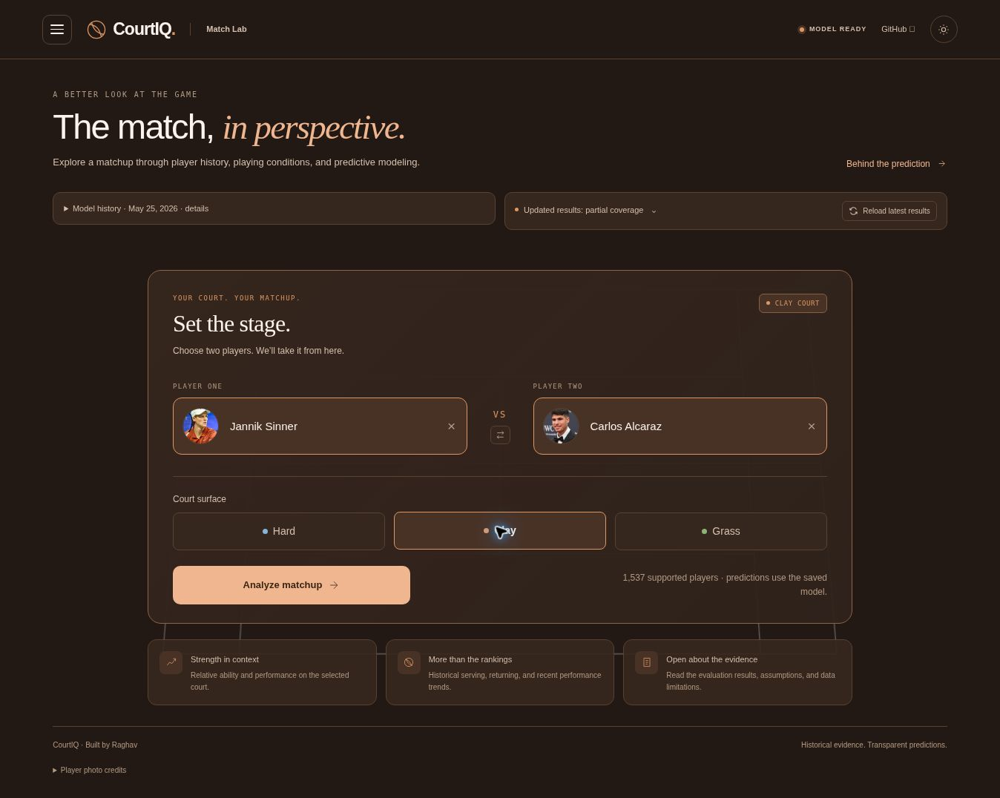

# CourtIQ

**Tennis match predictions, with the evidence behind every estimate.**

[**Open the live app →**](https://courtiq-virtualhelix.vercel.app/) · [Deployment guide](docs/deployment.md)

[](https://github.com/VirtualHelix/AI-Tennis-Match-Predictor/actions/workflows/tests.yml)

CourtIQ turns a tennis research model into an interactive web application. Choose two players and a hard, clay, or grass court to explore their estimated win probabilities, historical strengths, head-to-head record, and recent results. Built by Raghav, the project connects chronological machine learning, a Python API, a responsive interface, and a results pipeline with durable state.

The released artifact supports **1,537 players** and contains model history through **May 25, 2026**. Updated match results arrive separately through SportStatsAPI. The interface identifies both dates: refreshing displayed results does **not** retrain the predictor or update its feature history.



[View the results screen](docs/screenshots/match-results.jpg)

## Explore a matchup

- **Match Lab:** player search, portraits, court-specific themes, dark mode, and a separate animated results screen. The calculation sequence follows actual server milestones and respects reduced-motion preferences.
- **Match outlook:** complementary win probabilities, year-to-date and overall recorded head-to-head, the last three meetings, and each player's three latest matches. Surface badges and individual set scoreboards make the record readable; unavailable set scores stay explicitly unavailable.
- **Player Compare:** historical serving, returning, first- and second-serve performance, aces, double faults, and break-point rates, alongside the amount of supporting history.
- **Model Report:** historical evaluation, an Elo comparison, calibration data, feature groups, and interactive explanations of the saved model's equations.

## Model and evidence

The predictor combines **logistic regression with interactions** and **CatBoost**, using 178 input features: overall and surface Elo, time-weighted serving and returning, common-opponent comparisons, and recent performance relative to prior expectations. Training examples begin in 2010; older records initialize history. A five-year half-life reduces older examples' training weight.

The mixture was selected using 2024: **75% logistic regression and 25% CatBoost**. Both player orientations are evaluated so swapping players complements the probability. Training and serving share [courtiq/model.py](courtiq/model.py); its source hash is checked against the saved artifact.

### 2025 historical evaluation

These figures come from the evaluated model's saved report, exposed by `/api/evaluation` and the Model Report screen.

| Metric | CourtIQ | Elo baseline |
| --- | ---: | ---: |
| Correct predictions | 1,507 / 2,275 | 1,453 / 2,275 |
| Winner accuracy | **66.24%** | 63.87% |
| ROC AUC | 0.71965 | 0.70494 |
| Log loss ↓ | 0.61231 | 0.63040 |
| Brier score ↓ | 0.21268 | 0.22025 |

That is 54 additional correct predictions and a **2.37 percentage-point** difference. It is a descriptive historical comparison, not a significance test or future-accuracy claim. The season has already informed development. The calibration plot assesses reliability; no separate probability calibrator is fitted.

ATP records use tournament-start dates. A **21-day availability proxy** determines when results enter feature history, approximating publication timing. Shot-charting features are disabled in this artifact. The website uses a generic best-of-three ATP context with an unspecified round; evaluation used recorded match context.

## Engineering

The shared prediction service powers the local launcher and FastAPI deployment. Streamed NDJSON events drive calculation progress. The API bounds request sizes and inference concurrency, checks application origins, and exposes model readiness through `/healthz`.

A build verifies private artifact hashes, frozen source, and dependency versions before creating a compact serving bundle. A 73-case comparison found identical complete prediction payloads before and after compaction; fitted weights and full descriptive match history are preserved.

Hosted results use a scheduled job and a private Blob object holding pagination checkpoints, request reservations, a lease, and a published snapshot. Conditional writes prevent overlapping workers from overwriting newer state. Visitors read that snapshot rather than spending a tennis-provider request per page load.

Production runs on Vercel, with results refreshes scheduled every six hours. The GitHub repository is connected to Vercel, so updates to `main` automatically build and deploy the application.

## Run locally

Use **Python 3.12**:

```bash
git clone https://github.com/VirtualHelix/AI-Tennis-Match-Predictor.git
cd AI-Tennis-Match-Predictor
python3.12 -m venv .venv
source .venv/bin/activate
python -m pip install -r requirements.txt
```

Supply the owner's verified model at `models/courtiq/model.joblib`, with its `validation_predictions.csv` alongside for calibration. The model, private export, credentials, and generated serving bundle are excluded from Git; a fresh clone does not include a trained predictor. Existing installations can use the `models/research_v5/model.joblib` fallback.

```bash
python -m uvicorn app:app --host 127.0.0.1 --port 8000 --workers 1
```

Open `http://127.0.0.1:8000`. The local launcher also remains available as `python run_courtiq.py --port 8001`. Set `SPORTSTATS_KEY` in the process environment for local results updates; `.env` files are not loaded automatically. Without a key, saved historical records remain available.

## Source and verification

| Location | Responsibility |
| --- | --- |
| `courtiq/model.py` | Frozen research training, features, and prediction |
| `courtiq/server.py`, `courtiq/api.py` | Shared service and HTTP routes |
| `courtiq/static/`, `courtiq/assets/` | Interface, photographs, credits, and facts |
| `courtiq/sportstats.py`, `courtiq/history.py` | Results normalization and history reconciliation |
| `courtiq/results_job.py`, `courtiq/hosted_results.py` | Durable refresh job and snapshot reader |
| `scripts/`, `deployment/`, `tests/` | Export, verified builds, release manifest, and software tests |

```bash
python -m pip install -r requirements/dev.txt
python -m unittest discover -s tests -v
```

[GitHub Actions](https://github.com/VirtualHelix/AI-Tennis-Match-Predictor/actions/workflows/tests.yml) runs **169 software tests** on Python 3.12, covering API behavior, score normalization, artifact integrity, model compaction, and durable results updates. Synthetic fixtures test software behavior and are never displayed as tennis evidence. Original `src/` experiments remain; the web app uses `courtiq/`.

See the [deployment guide](docs/deployment.md) for Vercel, private artifacts, scheduled updates, and operating limits. Historical data comes from [Jeff Sackmann's ATP dataset](https://github.com/JeffSackmann/tennis_atp) and its [update fork](https://github.com/Kadantte/tennis_atp); updated records use [SportStatsAPI](https://sportstatsapi.com/docs/api/tennis-matches/). [Photo attributions](courtiq/assets/players/attribution.json) preserve authors and licenses. [Tennis facts](courtiq/assets/tennis_facts.json) retain source links.
