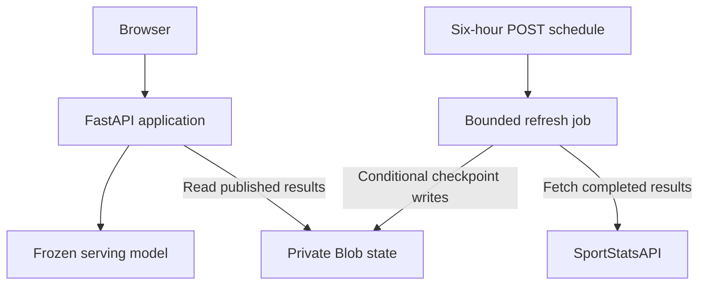

# Deploy CourtIQ to Vercel

CourtIQ deploys as a Python 3.12 FastAPI application using the root [app.py](../app.py). The browser, API, and saved predictor share one application origin. The model is supplied privately during the build; a separate scheduled request updates descriptive match results.

The deployment configuration is [vercel.json](../vercel.json). It selects the FastAPI framework, runs `python scripts/build_vercel.py`, includes the generated serving artifact, and schedules a results refresh every six hours. No Node frontend build is required.

## Runtime architecture



Prediction features come from the saved model history through **May 25, 2026**. The results feed supplies newer displayed records, head-to-head, and recent-match scoreboards. It does not update model features, change weights, or produce a new evaluation score.

## 1. Prepare the verified model export

For an existing installation, activate the environment that already runs its model and export before changing dependencies:

```bash
cd ~/Downloads/AI-Tennis-Match-Predictor
source .venv/bin/activate
python scripts/export_model.py
```

The default output is `~/Downloads/courtiq_model_bundle.zip`. The helper preserves existing outputs; use `--out` with a new filename for another export. It supports both the clean `models/courtiq/` layout and the legacy `models/research_v5/` plus `src/v5/tennis_research_model.py` layout. Explicit `--model` and `--model-code` options select another saved artifact and its exact source.

The exporter copies an allowlist, records original relative paths and SHA-256 hashes, and captures installed model dependency versions. It never unpickles, retrains, or uploads the model. The release build expects these five archive members:

```text
models/courtiq/model.joblib
courtiq/model.py
models/courtiq/validation_predictions.csv
requirements-model.txt
bundle_manifest.json
```

The general exporter permits a missing calibration CSV; **this verified deployment requires it**. It must belong to this evaluation, not another experiment.

[deployment/model.json](../deployment/model.json) identifies the approved release by archive size and hash, model hash, source hash, and calibration hash. [requirements/model.txt](../requirements/model.txt) records its exact dependencies. Root [requirements.txt](../requirements.txt) contains the flat production lock required by Vercel's dependency parser; [requirements/production.txt](../requirements/production.txt) retains the same runtime pins for development tooling. Keep both locks synchronized. A newly generated archive has its own metadata and hash. Review and verify a new release before updating the manifest; do not remove checks to make an unrelated export pass.

## 2. Connect private Blob storage

Create a **private** Vercel Blob store and connect it to the project. Upload the verified ZIP directly to that store using the Blob dashboard or SDK. Keep an immutable pathname for each release. The model archive is never served by a public application route or committed to Git.

Choose a separate stable pathname for results state, such as `courtiq/results-state.json`, in the same connected store. Its URL and the model URL use the form `https://<store>.private.blob.vercel-storage.com/<pathname>`. The first refresh creates the state object if absent; it should not be initialized with an arbitrary empty JSON document.

Configure Vercel environment variables as follows. Actual credentials belong in Vercel's environment settings, never in browser code or committed files.

| Variable | Value and purpose |
| --- | --- |
| `BLOB_READ_WRITE_TOKEN` | Connected private store's token. Required during build and runtime. |
| `COURTIQ_MODEL_BUNDLE_URL` | Exact private URL of the approved model ZIP. Build only; no query, fragment, or embedded credentials. |
| `COURTIQ_MODEL_PATH` | `models/courtiq/deployment.joblib` for the hosted application. |
| `COURTIQ_MODEL_CODE` | Optional; defaults to the package's `courtiq/model.py`. |
| `COURTIQ_RESULTS_STATE_URL` | Private URL for the durable results-state object written by the job. |
| `COURTIQ_RESULTS_SNAPSHOT_URL` | **The same state URL.** The reader extracts its published snapshot rather than exposing the whole document. |
| `SPORTSTATS_KEY` | Provider key used by the scheduled results job. |
| `COURTIQ_ENABLE_RESULTS_JOB` | `1` in Production; leave unset or set `0` in Preview. |
| `CRON_SECRET` | Random secret of at least 16 characters for the scheduled endpoint. |
| `COURTIQ_PUBLIC_ORIGIN` | Exact production HTTPS origin, without a path. Add this for a custom domain. |
| `VERCEL_SUPPORT_LARGE_FUNCTIONS` | `1`, with Fluid Compute and Active CPU enabled. Required for this dependency footprint. |

Vercel's configured deployment, branch, and production hostnames are accepted automatically. `COURTIQ_PUBLIC_ORIGIN` adds the explicit application origin; request headers cannot expand this allowlist. `COURTIQ_ROOT` is an optional local path override and normally needs no hosted setting.

For previews, provide the private model settings and snapshot reader settings, but keep the refresh job disabled. Preview visitors can inspect published results without starting another provider refresh process. Environment changes take effect on a new deployment.

## 3. Build the compact serving artifact

The build entrypoint [scripts/build_vercel.py](../scripts/build_vercel.py) performs the following sequence:

1. Downloads the private archive with a size bound and verifies it against the committed release manifest.
2. Rejects duplicate, unexpected, or oversized ZIP entries; checks member hashes, the export manifest, and exact dependency pins against both the repository and installed packages.
3. Confirms that the archived model source is byte-for-byte identical to the checked-in frozen source. The build uses the checked-in implementation.
4. Loads the verified model and compacts expired entries in bounded feature stores, preserving fitted weights, retained observation order, and the full original match history.
5. Publishes `models/courtiq/deployment.joblib`, `validation_predictions.csv`, and `deployment_manifest.json` only after verification and packing succeed.

The verified compact artifact is approximately **17.4 MiB**. A local comparison across **73 complete prediction payloads** found no numerical or structural differences. This check supports this artifact and source combination; changes to feature windows or the model implementation require revalidation. Packing does not retrain the model or establish new accuracy.

The original `model.joblib`, raw datasets, experiments, tests, and documentation are excluded from the deployed function. [`.vercelignore`](../.vercelignore) also keeps local model files and private environment files out of uploads. The build obtains its model from the verified private export instead.

To reproduce the build locally, use Python 3.12 with `requirements.txt` installed and the required build environment variables already set:

```bash
python scripts/build_vercel.py
COURTIQ_MODEL_PATH=models/courtiq/deployment.joblib \
  python -m uvicorn app:app --host 127.0.0.1 --port 8000 --workers 1
```

## 4. Deploy the repository

Import the existing GitHub repository into Vercel, keep the root directory at the repository root, and use the checked-in FastAPI configuration. Python 3.12 is declared in [`.python-version`](../.python-version); root `requirements.txt` contains the flat production lock. Link the Git repository in the project settings to enable future commit-triggered deployments. Do not configure a static output directory.

The dependency installation measured approximately **708 MiB** locally, so the standard 500 MB Python function bundle limit is insufficient. Enable the **Large Functions beta** using `VERCEL_SUPPORT_LARGE_FUNCTIONS=1` with Fluid Compute and Active CPU. Vercel currently supports Python bundles up to 5 GB in that mode. The configuration sets a 300-second maximum invocation duration. See the official [function limits](https://vercel.com/docs/functions/limitations).

Keep one inference worker per application instance, as implemented by `courtiq/api.py`. Model operations share mutable history state under a lock. Increasing process workers duplicates model memory; measured local peak memory with the compact artifact was approximately **1.1 GiB**, not a guarantee about every hosted workload.

## 5. Scheduled results updates

The repository uses **Vercel Schedules**, with this path target:

```json
{
  "schedules": {
    "refresh-results": {
      "schedule": "17 */6 * * *",
      "path": "/api/internal/refresh-results",
      "requestMethod": "POST"
    }
  }
}
```

The expression requests runs at 00:17, 06:17, 12:17, and 18:17 UTC. Hobby schedules have a 15-minute jitter window, so completion should not be presented as exact to the minute. Vercel sends `Authorization: Bearer <CRON_SECRET>` for this path target; the handler checks it before invoking work. Rotate the secret by updating its environment value and redeploying. See [scheduled path requests](https://vercel.com/docs/schedules/handle-runs) and [schedule limits](https://vercel.com/docs/schedules/limits).

Each job has a **200-second work budget**, reserves at most **12 provider requests**, and uses a **600-second lease**. The shared daily reservation ceiling is **90 requests**. Requests are spaced at least 12.5 seconds apart, and provider rate-limit/backoff responses are respected. Recent 28-day windows are visited first; pagination and earlier year-to-date work resume on later runs. Initial backfill can therefore span several scheduled runs.

The private state object contains the quota reservation, lease, pagination checkpoints, normalized results, and sanitized published snapshot. Every update uses the prior ETag as a compare-and-set condition. A delayed worker cannot replace newer state. Ownership is checked before each provider request, and a lost or unconfirmed write stops the job. Reservations remain consumed after a crash, avoiding accidental quota reuse. The provider key is not stored in the state document.

Hosted app instances read the published projection with a short in-process cache. The **Reload latest results** action reloads that projection; it does not contact SportStatsAPI. If a refresh fails, an instance retains its last successfully loaded snapshot and reports its age. A new instance can still show the saved model's historical records while a snapshot is unavailable.

## 6. Verify the deployment

Use the deployed origin in `COURTIQ_PUBLIC_ORIGIN` for these checks:

```bash
curl --fail "$COURTIQ_PUBLIC_ORIGIN/healthz"

curl --fail --silent --show-error \
  "$COURTIQ_PUBLIC_ORIGIN/api/predict" \
  -H "Origin: $COURTIQ_PUBLIC_ORIGIN" \
  -H 'Content-Type: application/json' \
  --data '{"player_a":"Jannik Sinner","player_b":"Carlos Alcaraz","surface":"Hard"}'
```

Readiness must report `model_ready: true`; a missing or incompatible model returns 503. Confirm one prediction on each surface, swap the players, inspect the streamed calculation sequence in the browser, and verify Player Compare and Model Report. The saved report should show 1,507 correct predictions out of 2,275 for 2025, with calibration drawn from the matching CSV.

Start one production refresh through the Schedules dashboard and inspect its result, logs, and `/api/results/status`. Verify that the snapshot timestamp and displayed recent records update while the model-history date remains May 25, 2026. Missing individual set scores must remain unavailable rather than becoming invented scores. Public requests without the schedule secret must receive 401 from the internal endpoint.

The repository's software tests run with:

```bash
python -m pip install -r requirements/dev.txt
python -m unittest discover -s tests -v
```

They cover score orientation and missing data, identity matching, history reconciliation, API failures and streaming, artifact integrity and compaction, snapshot validation, and competing/crashed refresh workers. They do not replace checking the deployed real model and provider integration.

## Hobby operating limits

This configuration targets a personal project on Hobby. The limits below were checked on November 26, 2026. Free usage is bounded, and beta availability or limits can change; review the linked platform documentation before another rollout.

| Resource | Relevant current limit |
| --- | --- |
| Function memory / CPU | 2 GB / 1 vCPU |
| Function duration | 300 seconds |
| Large Functions beta | Up to 5 GB uncompressed; requires the settings above |
| Schedules | Minimum 15-minute interval; 5,000 scheduled/manual runs per billing period per team |
| Blob | 1 GB storage, 10,000 simple operations, 2,000 advanced operations, 10 GB transfer included |

[Blob's Hobby policy](https://vercel.com/docs/vercel-blob/usage-and-pricing) pauses access when limits are exceeded rather than adding overage charges. Conditional checkpoint writes consume storage operations; model builds consume downloads, and visitors consume function and snapshot-read resources. Monitor those counters as well as the tennis-provider quota. More traffic is not automatically free, and a small model ZIP alone does not establish that the whole application fits the plan.

## Updating or rolling back

Code changes use the normal Git deployment flow. To release a different model, create a new immutable private archive, verify its source and dependency compatibility, compare its serving behavior, and update the release manifest and URL together. Keep the previous model release available while rollback is needed.

Keep the results-state URL stable across application deployments so quota reservations and pagination survive. A code rollback does not roll back this shared object. Coordinate state-schema changes, and do not delete the state to reset request allowances. If storage is unavailable, preserve the last known results and restore the connection before resuming refreshes.
